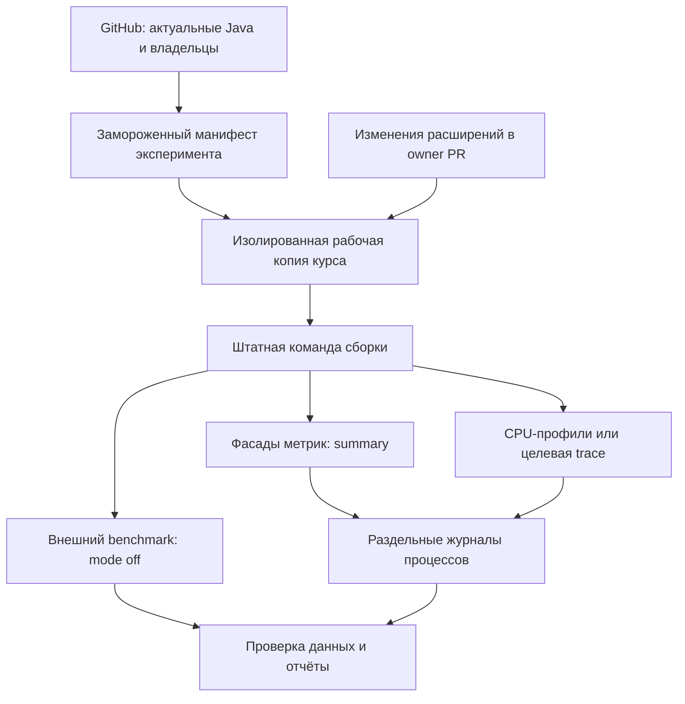

# Гибридная архитектура Performance

Основание: [требования](01-requirements.md). Детали API — в [03](03-contracts.md), порядок реализации — в [05](05-implementation-plan.md).

## Компоненты

Предлагаемое имя отдельного проекта — `quarto-course-performance`. Это имя не утверждает, что репозиторий уже существует. При реализации проверить существующие проекты и использовать согласованный отдельный owner; не превращать каталог с остальными владельцами в общий Git-репозиторий.



### 1. Source resolver и packager

Получает ветки из GitHub в начале работы, фиксирует SHA, собирает installable содержимое локально из этих checkout. Устанавливает owner-пакеты во **все** реально используемые `_extensions` рабочих копий Java. Не заменяет только корневую копию: дочерние проекты имеют собственные установки.

Предварительно проверяет совместимость текущих контрактов, конфигурации курса и runtime. Состояние `upstream` хранится отдельно от `clean-control` и `candidate` — см. [07](07-validation.md). Инструментированные временные файлы не попадают в release-архивы расширений.

### 2. Runner

Описывает команды как executable + массив аргументов + cwd + явные overrides env. Запускает штатный Quarto, не воспроизводит внутреннюю логику сборки. Управляет подготовкой рабочих каталогов, профилями `student/full`, чистыми/повторными сборками, порядком A/B и выгрузкой результатов.

Профиль Quarto и режим Performance — разные поля. `--profile student` не включает профилирование. Runner очищает унаследованные диагностические переменные для `off` и явно задаёт их для остальных режимов.

### 3. Небольшие фасады в расширениях

Каждый распространяемый пакет содержит локальные `observability/bridge.ts` и/или `observability/bridge.lua`, полученные из единого шаблона проекта Performance. Общая зависимость на установленный `course-core`, Performance или внешнюю registry для этого не нужна.

Фасад создаётся на уровне модуля, до выполнения функций. В режиме off фабрики обёрток возвращают исходные функции, без промежуточного вызова обёртки. Статические имена операций и одноразовая загрузка маленького файла остаются; их стоимость не объявляется нулевой.

Фасад не содержит сборщик, буферы, часы, парсер, преобразователь, FFI-модуль или viewer. Он предоставляет стабильный ABI агенту, который установлен только в диагностическом процессе. Копии шаблонов проверяются против одного канонического источника; не создавать несколько независимо развивающихся SDK.

Общие помощники обхода AST допустимы; в off они выполняют обычный обход. Дополнительный вызов помощника учитывается в проверке накладных расходов. Создавать атрибуты, обходить дерево и оборачивать callback на каждом узле в off запрещено.

### 4. Внутренние агенты TS и Lua

TS-агент использует отдельный синхронный стек и `AsyncLocalStorage` для async-контекста. Lua-агент хранит отдельные стеки корутин, обрабатывает multiple returns, tail calls и исключения. Оба агента реализуют один протокол, но не обязаны иметь одинаковую внутреннюю реализацию.

Установка агента — ответственность диагностического launcher. TS bootstrap добавляется первым import во временные **диагностические** entrypoints; он не превращает entrypoint в динамически импортируемый модуль и сохраняет `import.meta.main`. Если выбранная версия Deno предлагает подходящую штатную точку preload, её можно использовать только после такого же теста семантики. Нельзя предполагать, что внешние Deno flags сами распространяются на `quarto run`.

Lua bootstrap подключается через копию штатного Pandoc data-dir с дополненным `init.lua`. Существующая инициализация сохраняется. Проверить отдельные Lua states фильтров, короткие коды и загрузку модулей; bootstrap должен существовать в каждом наблюдаемом state.

Один агент на TS-процесс и один на Lua state. Присоединение нескольких фасадов не создаёт конкурирующие сборщики. Между state/process сохраняются общие experiment/run context и отдельные идентификаторы исполнителей.

### 5. Постоянная разметка

Размечать входы сборщиков, валидаторов, преобразований, чтение/запись крупными операциями, запуск инструмента и явные обходы AST. Стабильные operation_id отражают назначение, а не строку файла. Ручные таймеры в бизнес-коде не нужны.

Тело функции сохраняется читаемым. Регистрацию делать возле определения/экспорта, а функции callback — при формировании соответствующего регистра. Проверить внутренние aliases и рекурсивные вызовы: обёртка только экспортного свойства не перехватывает автоматически все локальные вызовы.

### 6. Дополнительная диагностика

- TS CPU: профилирование bundled Deno через диагностический launcher, отдельный профиль каждого процесса.
- Lua trace: стандартный call/return hook; исключить функции самого агента и не потерять frames переходов в native API.
- Lua CPU sampling: отдельный, необязательный backend со специально подготовленным Pandoc/Lua и проверенной совместимостью с Quarto. Не совмещать два Lua debug hooks без проверенного multiplexing; в пилоте выполнять отдельные запуски.
- TS trace: AST-преобразователь временных копий, выбранные модули, таблица соответствия исходникам, манифест покрытых/пропущенных конструкций. Начать с обычных функций и async-функций, реально присутствующих в выбранном модуле. Неподдерживаемые конструкции явно отмечать; строгий запрос полного охвата выбранного scope должен завершать preflight ошибкой при пробелах.
- Quarto adapter: наблюдение автоматических filter runs и границ traversal только в диагностической копии runtime. Привязка к конкретному runtime hash; никаких monkey patches в обычном исполнении.

Ручной слой описывает этап, автоматический — внутренние вызовы. Обёртку одной функции не дублировать. Разные виды событий могут быть вложены, но не суммируются как независимые затраты.

### 7. Сбор, проверка и отчёты

Каждый исполнитель пишет свой JSONL/summary. Буфер ограничен; переполнение отражается в quality, а точные counter и dropped trace events не смешиваются. В одном общем append-файле процессы не пишут.

Нормализатор проверяет ABI, идентификаторы, порядок, незавершённые интервалы и clock domains. Отдельные режимы и варианты сохраняют собственные run_id. Аналитика строит карту связей, таблицы этапов/функций/AST, coverage и сравнение обычных benchmark.

Минимальные outputs: `manifest.json`, `runs/<run_id>/`, `report.md`, `summary.json`, `coverage.json`, `quality.json`, `wall.trace.json`, `lua-cpu.trace.json`. Lua CPU-данные экспортируются отдельно; `wall.trace.json` не содержит Lua CPU-интервалов. По решению пользователя в пилоте шкалы TS и Lua не совмещаются. Для пилота достаточно файловых артефактов; сервер и постоянно работающий collector не нужны.

## Предлагаемая структура нового проекта

```text
deno.json
deno.lock
README.md
src/cli.ts
src/config/{types,validate}.ts
src/sources/{resolve,snapshot,packages}.ts
src/runner/{prepare,execute,benchmark,context}.ts
src/launchers/{deno,pandoc}.ts
src/protocol/{types,validate}.ts
src/agents/ts/{bootstrap,agent,context,writer}.ts
src/agents/lua/{init,agent,writer,trace}.lua
src/agents/lua/clock.lua
src/adapters/quarto/{capabilities,filter-trace}.ts
src/instrumentation/ts/{transform,symbols,coverage}.ts
src/analysis/{normalize,aggregate,compare,outputs}.ts
src/report/{markdown,perfetto}.ts
bridge/{bridge.ts,bridge.lua}
tools/sync-bridge.ts
scenarios/java.json
tests/{protocol,bridge,sources,runner,agents,instrumentation,analysis}/
tests/fixtures/
```

Это новая структура. Точки изменений существующих владельцев предварительные и повторно сверяются со свежими checkout. `clock.lua` реализует только явно обозначенный источник CPU-времени; native wall clock provider в пилот не входит.

## Замена прежней телеметрии

Существовавший `COURSE_BUILD_TRACE` и его внутренние таймеры не являются обязательной архитектурой. Разрешено заменить их, обновить owner tests/spec/README и оставить один источник метрик. Не сохранять legacy-адаптер только из осторожности. Если fresh discovery выявит документированный внешний контракт этого механизма, явно описать замену и реального потребителя; существенное изменение внешнего поведения вынести в review.

В измерении стоимости фасада старые таймеры сначала удаляются в `clean-control`. Иначе ускорение от их удаления могло бы скрыть затраты новой библиотеки.
