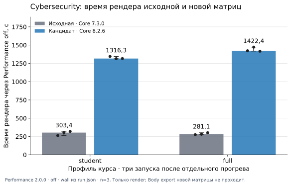
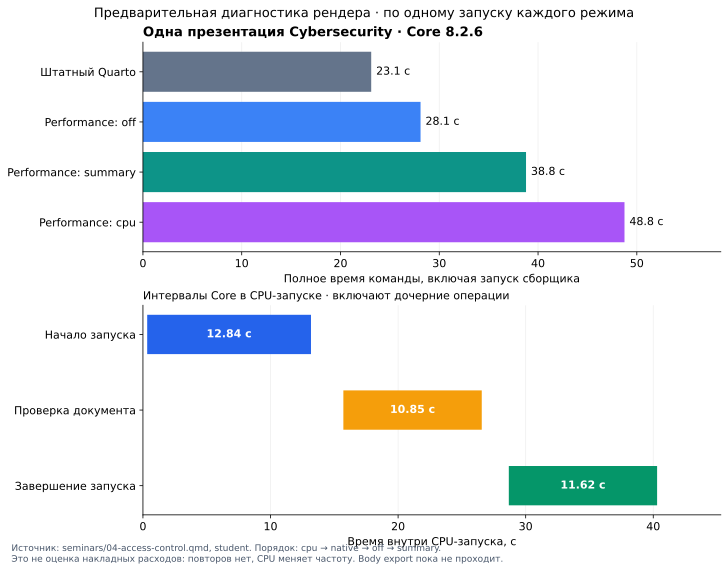

# Performance, Arch и проверка обновления Cybersecurity

25 октября 2026 года.

Arch-упаковка Performance 2.0.0 и инструкции установки опубликованы.
Core 8.2.6 объединил две линии разработки и прошёл проверки поставки и CI.
В Cybersecurity сохранены авторские входы, сверены 18 копий расширений,
проверены оба новых сайта и завершено render-only сравнение student/full.
Полная приёмка обновления и новый PR курса заблокированы отказом Body export.

## Выпуски Core и сохранение двух историй

Для 8.2.0–8.2.5 основание таблицы — сохранённые Release notes и проверенная
история предков. Старые полные suites в этой сессии заново не запускались;
их прежние утверждения о приёмке не являются новой перепроверкой.

| Выпуск | SHA | Линия и изменение |
| --- | --- | --- |
| [8.2.0](https://github.com/Afonenko-Course-Tools/quarto-course/releases/tag/v8.2.0) | `2e749ae08da9f1ca24e6058b8f80b40905714162` | Общая история: меньше повторных проверок владельца внутри операции; проверка изменений сохранена, постоянного кэша между операциями нет |
| [8.2.1](https://github.com/Afonenko-Course-Tools/quarto-course/releases/tag/v8.2.1) | `2850ea28bbf09ac49731d9675fa7f65efcce9c55` | Общая история: меньше повторного чтения inspection store; полные проверки границ фаз сохранены |
| [8.2.2](https://github.com/Afonenko-Course-Tools/quarto-course/releases/tag/v8.2.2) | `7c9388cb4d982caf66657ea8f96c09243d64a147` | Общий предок: временные native JSON при owned-экспорте нескольких документов и восстановлении конфигурации |
| [8.2.3](https://github.com/Afonenko-Course-Tools/quarto-course/releases/tag/v8.2.3) | `5267d1663f3c44ce4a1c24cfde5737f2bc963a56` | Линия наблюдения ABI 1: `extension_id`, контекст документа через публичный Lua API, наследование окружения при off/отсутствии агента |
| [8.2.4](https://github.com/Afonenko-Course-Tools/quarto-course/releases/tag/v8.2.4) | `7d8a472a0fe4f05b5543fb856336a6d15278ef3a` | Отдельная пакетная линия: меньше повторных чтений общих данных; исправлены завершение, восстановление и актуальность owned export; изменения наблюдения 8.2.3 сюда не вошли |
| [8.2.5](https://github.com/Afonenko-Course-Tools/quarto-course/releases/tag/v8.2.5) | `58fc5c9cb39867f6c612922eec9af09713539ca4` | Продолжение 8.2.4: CUE public checks требуют хотя бы одно из `input`/`state`/`action`, без defaults и изменения задания |
| [8.2.6](https://github.com/Afonenko-Course-Tools/quarto-course/releases/tag/v8.2.6) | `5b3b3a59866226506d9f305aec70289d69151b1d` | Обе истории объединены; пакетные проверки сохранены, добавлены четыре phase-ID ABI 1, исправлен поздний unhandled rejection артефакта |

`commonPathDocument` повторно проверял все входы уже в 8.2.2. Это не новая
регрессия 8.2.3. Сокращение subprocess-вызовов, чтения и сериализации в
8.2.4–8.2.5 само по себе не доказывает линейность или ускорение курса.

## Приёмка опубликованного Core 8.2.6

[PR #46](https://github.com/Afonenko-Course-Tools/quarto-course/pull/46) слит
обычным merge; обе истории 8.2.3 и 8.2.5 остались предками выпуска.
Дерево `5bfa5ec71114a653fd718f7dea6fb85f8f26716e` совпало с проверенным
`615987e62d71529ebd8d917db6ec4d10ee19429b`.

[PR CI 40130294984](https://github.com/Afonenko-Course-Tools/quarto-course/actions/runs/40130294984)
непрерывно прошёл 100 проверок на `615987e`.
[Merge CI 40137175340](https://github.com/Afonenko-Course-Tools/quarto-course/actions/runs/40137175340)
прошёл 100 проверок, 0 отказов на точном опубликованном `5b3b3a5`.
Сверены source tree, дерево расширений и тестов, digest скачанного CI-артефакта.

Локальные 100 проверок приняты составным прогоном: 1–90, Jupyter 91 после
устранения ограничений каталогов и локальных сокетов среды, затем 92–100,
включая три браузерных сценария. Код и хеши инструментов не менялись.
Это не непрерывный локальный запуск всего сценария с exit 0; исходные отказы
сохранены, прерванный ранний прогон не засчитан.

| Проверенный материал | SHA-256 |
| --- | --- |
| CI ZIP merge commit | `87f5f5e68a04f585f35f6fc1c45c92da2a584a3a08eafbd71e8b66449f45c54a` |
| Исходный TAR v8.2.6 | `22aa4657b5a04d1576c5ccb5482e526008254189d9ff4c89b0a1def5300bbfda` |
| Исходный ZIP v8.2.6 | `84f7b28678fae8cb1cf4a9fa4ac84c459d89e6cc117bdb1f1176f696c1688519` |

TAR/ZIP содержат ровно 377 отслеживаемых файлов: байты и исполняемые биты
совпали с Git, лишних файлов и символических ссылок нет. Штатный `quarto add` проверен
в корневой цели и цели заданий: в каждой 97 файлов — Core 72,
Presentation 13, Navigation 12 — совпали с источником.

Реальный `summary` системного Performance завершился с native exit 0,
`dataValid: true`, без ошибок качества, потерь и незавершённых spans.
Все четыре новые phase-операции `withLoadedNativeRun`, `withFinishedNativeRun`,
`withNativeRunProof`, `withNativeArtifactBatch` дали по одной завершённой паре
событий с `extension_id: course-core`, без `document_id`.
Starter-потребитель публичного API прошёл. Core API 8.1, Body v2 и ABI 1 сохранены;
общий runtime или постоянный общий кэш не добавлены. `coverageComplete: false`.

Ревью выявило поздний отказ pending-артефакта после ошибки callback.
Исправление `615987e` прошло реальный Deno RED → GREEN: отслеживается тот же
публичный Promise, сохранены исходная ошибка callback и проверки срока жизни resolver.
Успешная матрица Core не покрыла описанный ниже сценарий Body export.

## Arch-упаковка и системная установка

[Выпуск упаковки v2.0.0-1](https://github.com/Afonenko-Course-Tools/quarto-course-perf-arch/releases/tag/v2.0.0-1)
опубликован с коммита `0cca0bf3f5243ccf946b314d9fb548abb3942ef1`.
[Hosted CI 40123616232](https://github.com/Afonenko-Course-Tools/quarto-course-perf-arch/actions/runs/40123616232)
успешен на этом точном SHA. Полная локальная приёмка выполнена на
`76aecc9991277ec40b0f370684df8f49c880bb4f`; финальный коммит отдельно принят CI
после узких исправлений совместимости среды и русского текста.

Приложение остаётся Performance 2.0.0, исходник
`f79d4f7e4cf2d235ae7d35a7b6a1b7a6be42486f`. Его тег и Release assets не заменялись.
Заново скачанные материалы выпуска упаковки сверены по контрольным суммам;
`.SRCINFO` репозитория опубликован как `SRCINFO`, что отражено в `SHA256SUMS`.

| Материал | SHA-256 |
| --- | --- |
| Исходный архив приложения 2.0.0 | `3e80cdf03f807ba146541ae27285870de603bd96dbebc3022d57691d48a470c7` |
| Опубликованный пакет из CI | `0dedc9e049193142c5f83b2009ff733a4e9a8bfe4288e9685edb8a9d991b1564` |
| Локально собранный пакет | `296f5a58cc94de6bfcbd3bc5d2e2f7d553684d2f6f65fbf37c8a0c83fc8a0cf5` |
| Совпавшее установленное дерево приложения | `6bf496e842e60342fd269be3b87fd18414c1ee8beba1b72489e240551e2a30ba` |

Проверены сборка makepkg, установка pacman, публичная команда, настоящий
summary-рендер и trace. Непривилегированный запуск без сети прошёл с пустым
Deno-кэшем, чужим `deno.json`, защищённым деревом приложения и сложным путём.
Три контроля отказа обнаружили отсутствие настоящего Quarto, испорченный архив
и устаревшую `.SRCINFO`. Установленное дерево до и после запуска совпало.

Системная установка выполнена пользователем: pacman подтверждает
`quarto-course-perf 2.0.0-1`, сверены 185 файлов. Runtime совпадает с опубликованной
поставкой; подтверждена работа публичной команды версии 2.0.0.
Побайтная воспроизводимость бинарного пакета не заявляется.
Лицензия upstream не объявлена; `namcap` содержит ошибки лицензии и эвристические
замечания, поэтому чистая проверка `namcap` не заявляется.

После подготовки `base-devel`, Git и настоящего pacman-пакета Quarto:

```sh
git clone https://github.com/Afonenko-Course-Tools/quarto-course-perf-arch.git
cd quarto-course-perf-arch
makepkg -si
```

Обновление — `git pull --ff-only`, затем `makepkg -si`. `makepkg` не получает
зависимости из AUR автоматически. `prepareArchSource(commit, output)`, внутренний
PKGBUILD и оболочка остаются у Performance. Установленные docs приложения
сохраняют исторический маршрут 2.0.0; актуальный путь описан в репозитории упаковки.

## Cybersecurity: сохранённый источник и незавершённый этап

Сохранён пилот семинара 4 от авторского
`77cb627585c5a92666800845afeecbdcd9c87cce`: 13 вопросов, пять обязательных и
восемь необязательных назначений, 13 решений, пять интерактивных схем с печатью,
презентация и исправления навигации/QRC-ссылки. Авторские входы не менялись.
Снимок содержит 923 файла; staged candidate tree —
`e55e5c9247c4f333a93721144f8d11a306fb4fc9`. Это tree, а не commit курса.
До исправления Body новый commit и новый PR курса не создаются.

Установлены 18 копий целых опубликованных пакетов матрицы ниже.
Инвентарь дал 18 PASS по файлам, байтам и исполняемым
битам `0111`; разница обычных прав `0664`/`0644` не объявляется расхождением байтов.
Print, Moodle, PrairieLearn и Cloud не добавлены.

Исходный цикл student/full/student, девять предметных проверок и Body-экспорты
прошли; все пять отрицательных контролей обнаружены. Checker `9d77ce5` дополнен
проверкой переименованных Body, служебных исходников обоих сайтов и окон из
12 слов для сохранности/утечек решений. Три замечания прошли RED → GREEN.

Оба новых сайта на Core 8.2.6 отдельно проверены:

| Результат | student | full |
| --- | --- | --- |
| HTML / локальные ссылки | 64 / 3687 | 67 / 4020 |
| Reveal-экраны / QRC-ссылки | 25 / 123 | 25 / 123 |
| QRC targets | 112 | 142 |

Строго сравнены целиком все 64 student/67 full HTML: по 25 файлов побайтно равны;
остальные 39/42 отличаются только одним сгенерированным `<p class="date">`
в `header#title-block-header` (24 → 25 октября 2026 г.). Первоначально обнаруженные
81 различие в `bodytext` объяснены этим точным контролем даты: `task/_quarto.yml:59`
задаёт `date: today`, запуски пересекли полночь Europe/Minsk. Другие байты не
нормализованы; содержательных HTML-различий нет. Этот контроль не относится к Body.

Полная сверка файлов использует парные срезы измерений:
`old-off-student-3` → `updated-off-student-3` и
`old-off-full-3` → `updated-off-full-0` (warm0). Имена всех 238/241 файлов совпали, добавленных и
удалённых нет. Кроме 39/42 HTML, изменились только `search.json` и `task/search.json`:
оба JSON целиком побайтно совпали после замены только точной фразы даты
24 → 25 октября 2026 г. — по 36 вхождений в каждом файле student и по 39 в full,
без удаления полей или иной нормализации. Остальные 172 не-HTML файла каждого
профиля, включая sitemap, catalog и assets, побайтно равны. Исторические
functional baseline-sites в эту сверку ресурсов не входили. Парный full-срез
взят из warm0; его outputs затем побайтно совпали со всеми full1–3.

Проверены 13 решений только в full, student HTML/search/resources, схемы, печать,
Reveal и guards служебных JSON. Все объекты QRC targets целиком равны baseline:
нет изменённых, добавленных и удалённых объектов. Это не семантическое сравнение Body.

Первый штатный student прошёл за 20 мин 53 с. Следующий Body JSON export отказал:
`NATIVE.COMMON_PATH_BINDING_INVALID` — не подтверждён scalar native JSON output
recipe. Отказ воспроизведён публичным `collectExport` с поддерживаемыми
Core/QRC hooks и локальным `format: html`. Обычный inspect видит HTML без JSON
recipe, хотя экспорт запускает `render --to json`; предварительный допуск Core
ошибочно требует recipe до рендера. Контроль без локального `format` прошёл,
но изменение авторских настроек не считается исправлением.

Семантическое сравнение Body не выполнено из-за FAIL экспорта; весь цикл курса
не принят. Дата первоначального внесения дефекта не установлена. Release notes
8.2.6 отмечают известный дефект, тег неизменен. Исправленный выпуск не заявляется.

## Измерения рендера и границы диагностики

Обе матрицы измерялись системным Performance 2.0.0: Quarto 1.11.6,
Deno приложения 2.9.8, Deno Quarto 2.7.14, Pandoc 3.10, CUE 0.17.1.
Baseline взят из авторского `77cb627585c5a92666800845afeecbdcd9c87cce`:

| Владелец | Baseline | Новая версия | Точный SHA новой версии |
| --- | --- | --- | --- |
| Core / Presentation / Navigation | 7.3.0 | 8.2.6 | `5b3b3a59866226506d9f305aec70289d69151b1d` |
| QRC | 3.1.0 | 3.1.1 | `989448d2afa4df7db882b0874c88808a00ae52c2` |
| Publisher | 5.1.1 | 5.1.4 | `a0fc543fb461d90b9f467dbe8b6a0b286a39311a` |
| Download | 3.1.0 | 3.2.2 | `10cb38f2ba5c88e585a0ff6800adf5fc2b77597e` |

Это не сравнение 8.2.3 → 8.2.6: прерванная матрица 8.2.3 и namespace-попытка исключены.
В каждой student/full-серии прогрев исключён, измеряемая выборка n=3.

| Off: native wall, с | Запуск 1 | Запуск 2 | Запуск 3 | Медиана | Диапазон |
| --- | --- | --- | --- | --- | --- |
| Исходный student | 262.931566992 | 303.373829422 | 320.252383558 | 303.373829422 | 262.931566992–320.252383558 |
| Новый student | 1344.96610153 | 1313.874525495 | 1316.255386809 | 1316.255386809 | 1313.874525495–1344.96610153 |
| Исходный full | 274.482411428 | 281.067619805 | 301.870866667 | 281.067619805 | 274.482411428–301.870866667 |
| Новый full | 1422.420525726 | 1472.781966559 | 1416.780041532 | 1422.420525726 | 1416.780041532–1472.781966559 |

Новая медиана student в 4.3387242377 раза выше исходной, full —
в 5.060776928743523 раза. Это наблюдаемое замедление render-only матрицы
на одном ноутбуке; одновременно обновлялись Core, QRC,
Publisher и Download, причина не приписывается одному пакету.
Все измеряемые запуски завершились с exit 0, валидными данными, без ошибок
качества, потерь и незавершённых spans. Во всех четырёх новых запусках каждого
профиля, включая прогрев, совпали имена и байты outputs без нормализации:
449 файлов student и 455 full.

| Медианы n=3 | CPU user, с | CPU system, с | Peak RSS, KiB |
| --- | --- | --- | --- |
| Исходный student | 332.92 | 25.41 | 504580 |
| Новый student | 1432.23 | 173.69 | 413400 |
| Исходный full | 314.39 | 23.12 | 504668 |
| Новый full | 1536.32 | 185.81 | 383584 |

В каждом профиле записанные power/governor/cwd/environment всех восьми
old/new запусков совпали. Исходные серии выполнены раньше новых, порядок
не рандомизирован. Мгновенная частота CPU и фоновая нагрузка не фиксировались.
Параллельные native render/build не запускались; лёгкие проверки Git и файлов
продолжались. Это не изолированный эксперимент с неизменной нагрузкой ноутбука.
Общий график student/full показан и визуально проверен; доступны SVG и PNG.



[PNG графика](2026-10-24-arch-cybersecurity/render-comparison.png), [исходная числовая сводка JSON](2026-10-24-arch-cybersecurity/performance-comparison.json).

Новый full warm0 прошёл за 1384.370091027 с и исключён из выборки.

Для одной презентации `seminars/04-access-control.qmd`, профиль student,
получено по одному наблюдению внешней длительности: native 23.1093 с,
off 28.1055 с, summary 38.7830 с, cpu 48.7518 с; все exit 0.
Все 320 outputs off/summary/cpu побайтно совпали с native. У инструментированных
запусков `dataValid: true`, пустой `quality.errors`, нулевые `droppedEvents` и
`incompleteSpans`, `coverageComplete: false`.
Внутренняя длительность CPU-запуска — 45.29 с. Это не оценка overhead.



[PNG диагностики](2026-10-24-arch-cybersecurity/target-diagnostic-8.2.6.png), [числовые данные JSON](2026-10-24-arch-cybersecurity/target-diagnostic-8.2.6.json).

В target-запуске 71 зарегистрированный receipt процессов, а не все процессы ОС.
В `seminars` установлены `course-core`, `course-presentation`, `course-navigation`
и `reference-catalog`; события всех четырёх записаны вместе с родительским hook
`course-site`, который не является пятым пакетом проекта.
Speedscope проверен на V8-профиле одного процесса. Он не измеряет CPU Pandoc/Lua;
Lua sampling недоступен. Inclusive spans не являются независимыми self-time
и не устанавливают причину задержки. Сырой CPU-профиль с локальными путями
в публичные материалы не включён. Эти данные не закрывают отказ Body.

Множества processId 43 V8-профилей и 43 зарегистрированных Deno receipts совпали.
В трёх исходных профилях есть по одному отрицательному `timeDelta`: −2/−3/−2 мкс.
Байты сохранены без исправлений; строгая валидность timestamps не заявляется.
Это отдельно от `dataValid` запуска. Выбранный для Speedscope профиль этих
предупреждений не имеет.

На зафиксированном этапе прошли одиночные summary проектов `theory`, `task` и `seminars`
с профилем student, подготовленные из среза нового student3. Для `theory`:
внутренний/внешний wall 261.21671982799995/267.546480642 с, CPU user/system
275.53/38.69 с, peak RSS 398928 KiB. Для `task`: внутренний/внешний wall
1047.673043503/1065.834934173 с, CPU user/system 1075.33/163.39 с,
peak RSS 528404 KiB. Для `seminars`: внутренний/внешний wall
100.201621848/105.198455902 с, CPU user/system 108.53/15.64 с, peak RSS 380332 KiB.
Все три запуска имеют exit 0, `dataValid: true`, нулевые ошибки,
`droppedEvents`/`incompleteSpans` и `coverageComplete: false`. В `task` наблюдено
128 операций с атрибуцией `course-core`, `course-presentation`, `project-download`,
`reference-catalog` и родительского hook `course-site`. В `seminars` наблюдено
98 операций всех четырёх установленных пакетов и родительского hook `course-site`.
Это одиночные наблюдения, не оценка overhead и не измерение корня.
Отдельные native/summary проверки корня для student и full не выполнялись.
Четыре режима одной презентации проверены выше;
диагностическая матрица остаётся неполной.
[Числовые данные подпроектов](2026-10-24-arch-cybersecurity/project-summary-diagnostics-8.2.6.json).

## Документация Performance и Template

Инструкции опубликованы обычным merge
[PR Performance #3](https://github.com/Afonenko-Course-Tools/quarto-course-performance/pull/3):
`cbad45039ef6453761191a9b4b190333cbfa80f8`.
[PR CI 40143393519](https://github.com/Afonenko-Course-Tools/quarto-course-performance/actions/runs/40143393519)
успешен на `93af8777f2d6813db0621a0f2bfee28898847a34`,
[merge CI 40143783190](https://github.com/Afonenko-Course-Tools/quarto-course-performance/actions/runs/40143783190)
— на точном `cbad450`. Изменены README и две инструкции, приложение не менялось.

Template на `73a75243df47867a21e9f683ca5e396c5662f3db` прошёл install/fetch/render/check
и `tests/fetch.py`: 2777 ссылок, 64 HTML, восемь готовых групп, Body и HTML/Reveal.
[CI 40121907799](https://github.com/Afonenko-Course-Tools/quarto-template-course/actions/runs/40121907799)
успешен; [PR #25](https://github.com/Afonenko-Course-Tools/quarto-template-course/pull/25)
слит в `4f257e4c612c282c313db78304696562d9278b8d`. Готовые pins и Taskfile сохранены.
Штатная публикация принята с source SHA `4f257e4c612c282c313db78304696562d9278b8d`;
gh-pages commit — `aaf194fb9d47fa7ae06f9623ddcd245c4884a6e6`.
[Публичная страница Performance](https://afonenko-course-tools.github.io/quarto-template-course/guide/performance.html)
отвечает HTTP 200, содержит новую Arch-ссылку и побайтно совпадает с принятой
локальной HTML-страницей. SHA-256 обеих —
`25c769b36bdc5a761338d86b7b6e18cef6766a19ab786d78f4114c464028bf1d`.

Публикация принята составным циклом. Первая попытка не нашла Task в PATH;
после исправления PATH штатный `task check` прошёл все проверки. Нативная
публикация Quarto сначала отказала при push из-за DNS. На том же источнике
повторён только этап нативной публикации с `--no-render --no-prompt --no-browser`,
завершившийся с exit 0. Непрерывный `task publish` с exit 0 не заявляется;
ручной Git push не использовался.

Для сохранения истории проверен архив 39 ссылок на слитые ветки в семи Git bundles.
25 октября в 02:42:06 UTC применён этап очистки архивированных слитых веток,
не занятых рабочими деревьями: удалены 37 remote refs и 2 local refs.
Сохранность невыбранных remote refs, тегов и локальных SHA проверена.
Все ветки курсов оставлены нетронутыми; сохранены четыре неслитые ветки
инструментов, пользовательские worktrees, ветки открытых PR, main, gh-pages,
теги и Releases.
