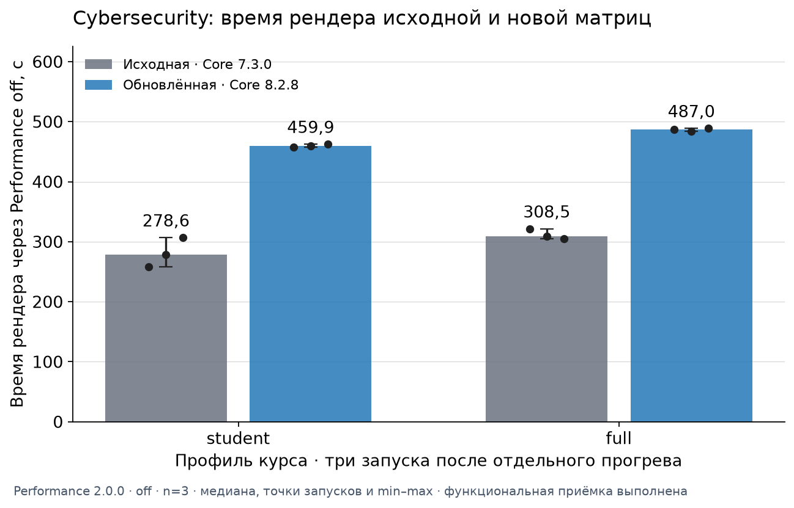
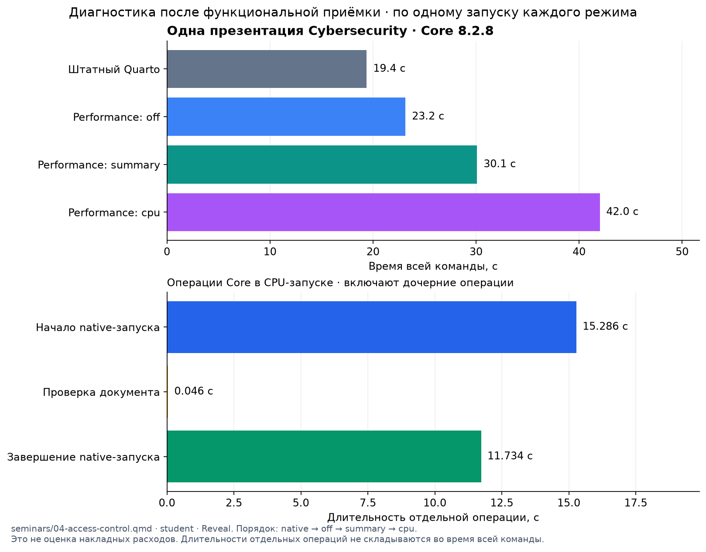

# Core 8.2.8: JSON-экспорт и повторное измерение Cybersecurity

25 октября 2026 года, Europe/Minsk.

Core 8.2.8 объединяет историю 8.2.6 с оптимизациями опубликованного 8.2.7,
исправляет штатный экспорт Body в JSON при локальном HTML-формате и сохраняет
диагностику пакетных операций. Курс принят на целых опубликованных пакетах;
новая матрица из 27 запусков выполнена отдельно от прежних измерений 8.2.6.

Измеренная медиана времени `off` относительно исходной матрицы Core 7.3.0: student — выросла на 65,1%, full — выросла на 57,9%. Это результат совокупной матрицы пакетов; эффект одного Core отдельно не выделяется.

## История минорных выпусков

Для 8.2.0–8.2.5 использованы опубликованные описания и проверенная история
предков. Их прежние полные наборы проверок заново не выполнялись. Подробные SHA и
результаты прежней попытки сохранены в
[отчёте 8.2.6](2026-10-24-arch-cybersecurity.md).

| Выпуск | Линия и смысл изменения |
| --- | --- |
| 8.2.0 | Общая история: меньше повторных проверок владельца внутри операции; без постоянного кэша между операциями |
| 8.2.1 | Общая история: меньше повторного чтения inspection store; полные проверки границ фаз сохранены |
| 8.2.2 | Общий предок: временные native JSON при owned-экспорте нескольких документов и восстановлении конфигурации |
| 8.2.3 | Линия наблюдения ABI 1: `extension_id`, публичный Lua document context и наследование окружения |
| 8.2.4 | Пакетная линия: меньше общих чтений; завершение, восстановление и актуальность owned export. Изменения наблюдения 8.2.3 сюда не вошли |
| 8.2.5 | Продолжение 8.2.4: CUE public checks требуют хотя бы одно из `input`/`state`/`action` |
| 8.2.6 | Обычный merge обеих историй; четыре пакетные фазы ABI 1, исправление позднего отказа pending-артефакта |
| 8.2.7 | Продолжение линии 8.2.5: проверки выбранного документа внутри активного запуска, полные проверки BEGIN/END. История 8.2.6 сюда не вошла; JSON-дефект сохранялся |
| 8.2.8 | Обычный merge 8.2.6 и 8.2.7 с сохранением обеих историй; исправление JSON и отдельные проверки отказов, восстановления и повторного capture |

Оба исходника — 8.2.6 `5b3b3a59866226506d9f305aec70289d69151b1d`
и 8.2.7 `069251845a1803f1993ff2b09b30a2e0e275b04a` — проверены как предки
8.2.8. Сам 8.2.7 продолжал 8.2.5
`58fc5c9cb39867f6c612922eec9af09713539ca4`. Теги и выпуски прежних версий
сохранены; интеграция добавляет новую историю поверх обеих линий.

`commonPathDocument` повторно проверял весь подпроект уже в 8.2.2; это не новая
регрессия только 8.2.3. В контрольном примере нового выпуска N1/N3 дают inspect 5/7 и raw
Pandoc 16/16. Эти бюджеты не являются временем рендера Cybersecurity.

## Почему отказывал JSON и что изменилось

При настоящих Core/QRC hooks и локальном `format: html` экспорт принудительно
выбирал JSON, однако ранняя проверка ожидала scalar JSON recipe из inspection.
Inspection отражал HTML-конфигурацию. Отказ возникал до того, как настоящий
writer успевал подтвердить JSON. Контроль без локального HTML проходил.
Сценарий воспроизведён на опубликованном 8.2.7, а не выведен только из кода.

Новый допуск использует фактический `PANDOC_STATE.output_file` до записи,
связанный с native cwd, исходным документом и форматом. Публичный
`quarto.doc.output_file` может обозначать конечный output, поэтому отдельно
не заменяет временный writer. Конечные private intent-записи относятся к
неизменяемому pointer и не выдаются за доказательство готового JSON.

Сохранены отсутствие output до записи, source/protected collisions,
same-owner, held FD identity, запрет alias/duplicate outputs и проверка
актуальности до и после операции. При завершении независимо проверяются все
выбранные документы, адаптеры, готовые JSON и relocation. Ошибка или прерывание
восстанавливает авторскую конфигурацию; чужие появившиеся файлы не удаляются.
Оставшиеся owned failure entries сохраняются в частной quarantine.

Core API 8.1, Body v2 и ABI 1 сохранены. Private source-context v2 требует
нового capture. Новый общий runtime, постоянный общий кэш и второй парсер
не добавлены.

## Проверка выпуска

[Core v8.2.8](https://github.com/Afonenko-Course-Tools/quarto-course/releases/tag/v8.2.8)
опубликован с `b0dad2522e69a673c060ba3963f8fb0ba1e0b85d` после обычного merge
[PR #47](https://github.com/Afonenko-Course-Tools/quarto-course/pull/47).
Дерево совпало с проверенным `a6f0c2cd6ffc150deba5e7e06d4eb792b278e72e`:
`a6160b54044efa66ddcbd99ae291dd938431e0dc`.

[CI head](https://github.com/Afonenko-Course-Tools/quarto-course/actions/runs/40186667854)
и [CI merge](https://github.com/Afonenko-Course-Tools/quarto-course/actions/runs/40191752004)
отдельно прошли по 108 проверок, 0 отказов. Сохранены все 100 проверок 8.2.6,
включая Lua performance document context, и добавлены восемь проверок.
Артефакты сверены с digest GitHub и точными source/extensions/tests trees.

Локальный непрерывный набор проверок завершился с exit 0: 108 PASS и три браузерных
сценария. Во время него изменился только текст README примера: код, тесты
и инструменты оставались теми же. Поэтому локальный результат относится к
неизменному составу исполнявшегося кода, а не к одному неизменявшемуся Git ref.
Точные финальные refs независимо проверены обоими CI.

| Материал | SHA-256 |
| --- | --- |
| TAR v8.2.8 | `f7ab1045209cae18890ca5acf52eafdfa4c736d0ebf5a31a27ca789966ea72c4` |
| ZIP v8.2.8 | `c2ac4247d4b9ae56451939ba436726ff38f1dbf01cd7221d478dca1dd802cf7f` |
| CI ZIP head | `6b53451cb695653ab4fbfd73f74851a009bcfab8066fa53cbfc0e0b755dac280` |
| CI ZIP merge | `e8feeab299bf674bb9772352e74dce546095079c19f2afc2b553d4790ec71006` |

В каждом исходном архиве проверены 385 отслеживаемых файлов, байты и
исполняемые биты; лишних файлов и symlinks нет. Штатный `quarto add` по тегу
проверен в трёх целях: Core 74, Presentation 13 и Navigation 12 файлов на цель.
В JSON-цели отдельно установлен QRC 3.1.1. Реальный экспорт с локальным HTML
прошёл; авторские байты, inode, device, mode и mtime сохранены.

В настоящем `summary` системного Performance 2.0.0 все четыре пакетные фазы
дали по одной завершённой паре событий: `withLoadedNativeRun`,
`withFinishedNativeRun`, `withNativeRunProof`, `withNativeArtifactBatch`.
Каждая относится к `course-core`, без `document_id`. Реальный starter consumer
прочитал ожидаемые файлы через установленный Core. Потерь и незавершённых spans
нет; `coverageComplete: false`.

## Курс и отделение решений

Авторский пилот `77cb627585c5a92666800845afeecbdcd9c87cce` сохранён.
QMD, metadata, CSS, схемы и авторские assets не менялись при обновлении пакетов.
Новый снимок исходников содержит 931 файл; проверены все 18 физических копий
расширений, их списки, байты и исполняемые биты.

| Пакеты | Исходная серия | Новая серия |
| --- | --- | --- |
| Core / Presentation / Navigation | 7.3.0 | 8.2.8 |
| Reference Catalog | 3.1.0 | 3.1.1 |
| Publisher | 5.1.1 | 5.1.4 |
| Download | 3.1.0 | 3.2.2 |

Локальный полный цикл `student → model/Body → full → student` завершился успешно.
Проверены 64 student и 67 full HTML-страниц, 3687/4020 локальных ссылок,
по 25 экранов выбранной Reveal-презентации, все 13 решений только в full,
пять интерактивных схем и печатные представления. Все четыре teacher/public
Body побайтно совпали с исходной принятой матрицей. Девять Node-проверок
прошли; объявленный список программных проектов пуст. Backup сохраняет
одно назначение, семинар 4 — 13 slots: пять required и восемь optional.

Все 15 отрицательных контролей отклонены по ожидаемой причине: отсутствие
slot/solution, solution в public, испорченная QRC-ссылка, ID или текст решения
в student, изменённое решение full, служебные файлы и переименованный закрытый
Body. Отдельно проверен JSON с Unicode escaping. Состав страниц и QRC-цели
совпали с исходным курсом. Коммит измеряемого снимка курса:
`45d87c43278b76f8afe0b6d43b239455d0c1187f`; дерево `bef3e1641317679e4eb812ff5dc2cf6b6bad220b`.

Первый CI остановлен по лимиту задания 30 минут. После полной локальной
приёмки единственным изменением стало увеличение `timeout-minutes` до 90;
все остальные Git blobs, включая проверки и входные данные рендера, совпадают.
Итоговый коммит PR — `70c9a48540bb5789d710bcc787b28c3f499f96ce`, дерево
`6120ce5adf9ac2268bf23e96f6079caca5729792`. Отдельно завершён [CI курса](https://github.com/BSU-RFCT-Afonenko-Courses/Cybersecurity/actions/runs/40204289985)
на этом коммите. Его фактический checkout tree совпал с деревом итогового коммита.
В CI Quarto 1.11.5 проверены 64/67 страниц и 3633/3963 локальных ссылок;
локальные числа выше относятся к Quarto 1.11.6. Измеряемый снимок и Quarto
не менялись между случаями. PR курса остаётся открытым, публикация сайта
из него не выполняется.

## Методика и полная матрица

Все 27 случаев выполнены заново для этого отчёта. Исходная серия запускалась
после приёмки исходного курса; новая — после приёмки опубликованного 8.2.8.
Для каждого запуска использовалась новая копия снимка с сохранением mtime.
Время отдельного функционального цикла с Body-экспортами не входит во время
измеряемого render.
Корневые outputs и `.quarto` отсутствовали; внешние XDG/Deno caches общие.
У каждого профиля и редакции один отдельный прогрев исключён, затем три
измерения. Порядок исходная → новая, внутри student → full; рандомизации нет.

| Группа | Число случаев | Назначение |
| --- | --- | --- |
| Исходная/новая × student/full × прогрев и три запуска `off` | 16 | Сравнение полных рендеров |
| Новая × student/full × native/summary | 4 | Одиночная диагностика режимов |
| theory/task/seminars × summary | 3 | Отдельные подпроекты |
| Одна презентация × native/off/summary/cpu | 4 | Интервалы операций и V8 sampling |

Подпроекты и выбранная презентация использовали seed нового принятого
student-результата. Предварительный просмотр одной презентации с seed 8.2.6
не входит в эти 27 случаев. На ноутбуке render/build выполнялись последовательно;
системный фон, лёгкие Git/файловые действия, состояние CPU и браузерный просмотр
не исключены. Частота CPU не фиксировалась. Это наблюдение конкретного ноутбука.

Ноутбук: Intel Core i5-8250U, четыре ядра и восемь потоков;
`MemTotal` около 15,37 GiB. В исходных conditions зафиксирован governor
`powersave`; его режим не менялся для ускорения отдельной серии.

Toolchain: Quarto 1.11.6, его Deno 2.7.14 и Pandoc 3.10, CUE 0.17.1,
системный Performance 2.0.0 из Arch-пакета 2.0.0-1. Исполняемые файлы приложения и
контрольные суммы не менялись относительно принятой установки.
Performance запускается системным Deno 2.9.8; Quarto и его native hooks —
встроенным Deno 2.7.14. Поле Deno в `run.json.versions` равно `null`;
версии подтверждены отдельной проверкой toolchain и журналом пакетов.

| Профиль | Исходная медиана, с | Новая медиана, с | Новая / исходная |
| --- | --- | --- | --- |
| student | 278,584 | 459,900 | 1,651× |
| full | 308,518 | 487,010 | 1,579× |

У всех 27 случаев exit 0 и непустые outputs. У всех 24 запусков через
Performance `dataValid: true`, без ошибок качества, потерь и незавершённых spans.
Native-запуски (3) проверены по exit и GNU time; внутренних диагностических
результатов Performance у них нет. Выполнено 21 строгое побайтное сравнение
outputs: повторяемость серий, совпадение режимов и прямое старое/новое сравнение.
Нормализация HTML, JSON или дат не применялась.

На графике медианы трёх запусков, сами наблюдения и min–max. Измеряется
внутренний `outcome.wallSeconds` Performance, включая выбранный render,
без внешнего запуска CLI. У одиночной диагностики ниже показано внешнее
время всей команды; эти две величины не смешиваются.

[Числа сравнения](2026-10-25-core-8.2.8-cybersecurity/performance-comparison.json),
[полная числовая матрица](2026-10-25-core-8.2.8-cybersecurity/matrix-diagnostics.json),
[диагностика презентации](2026-10-25-core-8.2.8-cybersecurity/target-diagnostic-8.2.8.json).
Оба графика также доступны как SVG рядом с PNG.

## Perfetto, CPU и границы вывода

`wall.trace.json` открывается в локальном официальном
[Perfetto 58.2](https://github.com/google/perfetto/releases/tag/v58.2).
В локальном просмотре отдельно выбираются семь записей: полный курс
student/full, три подпроекта и выбранная презентация в summary/cpu.
В native/off трассы не записываются; эти случаи входят в числовую матрицу.
Его интервалы позволяют исследовать начало запуска, проверки документа,
завершение и дочерние операции; вложенные длительности не складываются во
время всей команды. Разные процессы сопоставляются только при имеющейся
калибровке; Lua CPU и отдельные local-wall файлы читаются отдельно.

CPU-запуск: зарегистрированные процессы — 51,
профили V8 CPU для Deno — 32,
выборки — 78409. Проверены привязка записи процесса к профилю,
состав профилей, node IDs, ссылки children/samples, число и конечность временных
полей; исходные байты не менялись. Это проверка зарегистрированных процессов,
а не доказательство наблюдения всех процессов ОС.

Отрицательных `timeDeltas`: 0 в
0 профилях. Они отражены отдельно;
требование строгой неотрицательности не подменяется исправлением raw bytes.
Speedscope показывает выборки CPU, а не точное число вызовов функций.

`dataValid`, отсутствие потерянных событий и полнота покрытия имеют разный
смысл. Во всех режимах полнота покрытия не объявляется. Единичные
native/summary/cpu запуски не оценивают накладные расходы. Сравнение старой и новой
матриц включает изменения четырёх владельцев и не выделяет эффект одного Core.

В репозиторий включены только проверенные графики и обезличенные числовые
сводки. Исходные трассы, журналы, teacher Body, решения и профили CPU остаются
локальными материалами проверки. Публикация сайта курса выполняется владельцем
отдельно; новый PR Cybersecurity остаётся OPEN.
